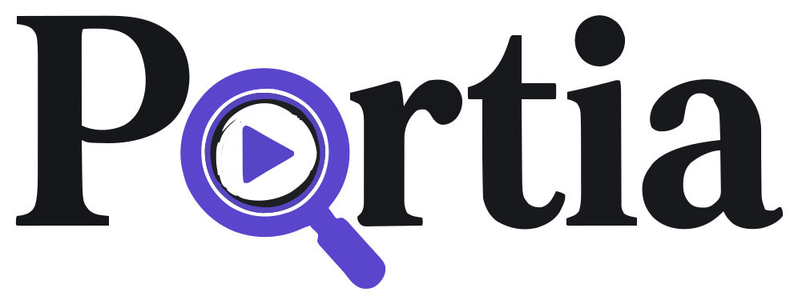

<p align="center"></p>

# Portia: every verdict turns on a detail

Live app: https://portia.shayekh.tech. Browsing and replaying every recorded investigation is open; starting new runs needs an access code. The [root README](../README.md) has the steps to run Portia elsewhere.

Portia checks AI answers about long videos against the footage itself. Given a question and two candidate answers, it
says which one the video supports, and shows its evidence.

1. Three investigators. Three Muse Glimmer 30B agents search about 100 hours of footage independently. Muse Glimmer
   is deployed on a Modal Endpoint and on Fireworks. Each agent searches
   transcripts and segments, scans contact sheets, zooms into frames and bursts through moments, then answers A or B.
2. Compare. If all three agree (three cases in four), that is the verdict.
3. Adjudicate. If they split, an adjudicator re-checks the disputed details on the investigators' own looks,
   without seeing their votes.
   - Muse Glimmer: the default, with no API cost.
   - Muse Spark 1.3 Contributor, on the Meta Model API: optional, about $0.004 per split. On this tier Meta may
     train on what is sent.
   - Muse Spark Open, on Baseten: optional, about $0.07 per split.
   - Muse Spark 1.3 checks every verdict: the best measured setup. Spark 1.3 also re-checks verdicts the three
     agents agreed on, because they are sometimes wrong together. About $0.004 per case.
   - Majority vote.
4. Verdict. The verdict card shows the answer, how it was reached, and the frames the deciding rationale
   cites, plus time, tokens and API cost.
5. Trust tier. Every verdict says how far to trust it: "Safe to accept", "Spot-check" or "Needs review". The tier
   is the measured development accuracy of the path that produced it: did the agents agree, did they settle it within
   their turns, what did the adjudicator do (`analysis/trust_tiers.py`).
   - With Spark 1.3 checking every verdict, 26% of cases are safe to accept at 93.4% right.
   - On Muse Glimmer alone, 27% are safe to accept at 88.7% right.

The name comes from Portia in *The Merchant of Venice*, who wins the trial on one exact detail of the bond.

## What Portia does

| Page | What it does |
|---|---|
| Cases | 220 development cases in 7 domains, 6 featured. The page opens on a looping replay of the demo case's search map (where the agents looked, then the frame the verdict cites); "Watch Portia catch a mistake" replays that case at 4 times speed. Each question shows first as Muse Glimmer's one-line version, with the full question one click away |
| A run | Live streaming of every agent turn (reasoning, tool calls, the frames it looks at); vote; adjudicator; verdict with cited frames; "Reveal the answer key" for library cases; cinematic replay at 1, 2 or 4 times speed; "Download report (PDF)" |
| New case | Check one answer (Muse Glimmer writes a variant with 2 to 3 details changed; the jury rules which one the footage supports) or compare two answers, over an indexed collection or an uploaded video (with optional .vtt/.srt captions). YouTube links are off on the public site (they download with yt-dlp, which YouTube's terms do not allow) |
| Audit | A whole eval run at once: paste or upload CSV/JSON lines; a live table of verdicts, trust tiers and costs; CSV/JSON export |
| Proof | The track record over 1,100 development runs, by domain and by how the verdict was reached; the check-all mode (82.0% in development, 81.6% held-out); "When to trust a verdict" |
| How it works | The pipeline, the development results, what we tried that did not help, and what was built during the hackathon |
| History | Every run, kept on disk and replayable |

## Run it

```bash
python product/server.py            # -> http://127.0.0.1:5250 (binds localhost)
```

Needs:

- Muse Glimmer: servers on ports 18660 and 18661 (`scripts/serve_muse.sh`: vLLM with DFlash speculative decoding;
  one is enough), or a hosted deployment set by `PORTIA_GLIMMER_SERVERS`, `PORTIA_GLIMMER_MODEL` and
  `PORTIA_GLIMMER_KEY` (Modal Endpoint or Fireworks: the main README has both).
- The query encoder on port 18531 (`scripts/local_encoder.py`, CPU is enough).

The top bar shows their state.

Settings (environment variables):

- `PORTIA_SPARK_BUDGET_USD` (default 5): the product's total Baseten spend. A hard cap of $90 across all runs also
  applies.
- `PORTIA_MAX_JOBS` (default 2): live runs at once. Later runs wait in a first-in, first-out queue.

## The static gallery (no server, no GPU)

```bash
python product/build_static.py [--live https://...]          # -> product/site/  (about 85 MB)
python scripts/static_server.py 5260 product/site               # try it locally (with HTTP Range requests)
```

It is the same app in static mode, showing the 220 cases and every recorded investigation; images are kept at 960 px.
It is made for GitHub Pages, so judges can browse and replay with no model server. New questions point to the live app's
URL.

## Demo video

`product/video/` builds the 3-minute narrated demo: the narration (`script.py`), the animated chapters (`scenes.py`,
manim), screen footage of the app driven by the narration (`record_narrated.py`), a new question run live and sped up
(`record_live.py`), and the join with captions and chapters (`portia_build.py`). `DEMO_SCRIPT.md` has the chapters,
the voice-over and the pitch.

## How it is built

| File | Role |
|---|---|
| `engine.py` | The pipeline. It calls the research code unchanged: `judge.agent.judge` for the investigators and `judge.adjudicate.adjudicate` for the evidence-only adjudicator. `TracedClient` and `TracedToolbox` record each turn and save each image. Each run is its own worker process (`engine.py run <id>`), so the web server stays responsive. |
| `server.py` | FastAPI: library, ground truth, proof, corpus, jobs, a server-sent event stream that resumes after a dropped connection, video ingestion, media |
| `ingest.py` | An uploaded video: the file (a YouTube link through yt-dlp only with `PORTIA_YOUTUBE_LINKS=1`, off on the public site), exact 30-second clips (ffmpeg), per-clip transcripts, text embeddings on the box encoder, and a collection in the corpus's own format (`engine.install_collections()` registers it) |
| `build_static.py` | The static gallery |
| `gloss_questions.py` | Muse Glimmer's one-line version of every library question (`glosses.json`); the benchmark's questions are long riddles written to be hard to search |
| `static/` | Plain HTML, CSS and JS with no build step; light and dark |

- Library cases use the exact settings of the logged runs, so they replay from the response caches in about 10
  seconds.
- Held-out shards (1, 2, 5, 6) are never offered.
- YouTube refuses some downloads (HTTP 403). Portia then asks for the file instead; it does not try to get around
  YouTube's protections.

## Track record (development shards 3-4, 220 cases x 5 independent investigator triples)

| Setup | Right | API cost per case |
|---|---|---|
| One Muse Glimmer agent | 72.9% | $0 |
| Three agents, majority vote | 74.0% | $0 |
| Portia (default): + Muse Glimmer adjudicator | 75.2% | $0 |
| Portia + Muse Spark 1.3 Contributor adjudicator (Meta Model API) | 78.8% | $0.001 |
| Portia + Muse Spark Open adjudicator (Baseten) | 80.5% | $0.017 |
| Portia + Muse Spark 1.3 checks every verdict (4 of the 5 investigator sets, 880 runs) | 82.0% | $0.004 |
| Held-out (shards 5-6, 316 contests): Portia on Muse Glimmer alone | 81.0% [76.6, 85.1] (vote 75.3%) | $0 |
| Held-out: Portia with Muse Spark 1.3 checking every verdict (audit 022) | 81.6% [77.2, 85.8] | $0.004 |
| Muse Spark 1.3 doing the whole investigation | (8 of 10 in a smoke test) | $0.011, measured |
| Muse Spark Open doing the whole investigation | (6 of 10 in a smoke test) | $0.185, measured |

- Splits are where the gain is: when the three agents agree, they are right 79.6% of the time. On splits, the
  majority is right 57.8%, the Glimmer adjudicator 62.6%, Spark 1.3 76.6% and Spark Open 83.0%.
- Agreement is not proof: in 15% of cases all three agents agree on the wrong answer. Re-checking agreed verdicts
  on the agents' evidence, Spark 1.3 fixed 59 such mistakes and broke 29 right answers over 880 runs: +3.4 points
  over Spark 1.3 on splits only, positive on each of the four investigator sets (plan 014). The Glimmer adjudicator
  cannot do this: on one set it fixed 8 and broke 9.
- Held-out: the jury on the untouched shards 5-6, pre-registered in `audits/021_final_push.md` (results in the root
  README). The held-out test of the Spark Open adjudicator stays pre-registered and unrun.
- The track record shown with a verdict is a development-set frequency for that kind of verdict, not a calibrated
  probability for one case.

## API

```
POST /api/jobs                  {"single": {"domain", "question", "answer"}            # check one answer
                                 | "custom": {"domain", "question", "answer_a", "answer_b"} | "case_id", "agents": 3,
                                 "resolve": "glimmer" | "spark13all" | "spark13" | "spark" | "vote", "quick": false}
GET  /api/jobs/{id}             the final verdict, how it was reached, track record, cost
GET  /api/jobs/{id}/events      server-sent events: every turn, look and frame, live
POST /api/batches               {"name", "items": [... up to 100 cases ...], "agents", "resolve", "quick"}
GET  /api/batches/{id}          per-case status, verdict and trust tier
GET  /api/batches/{id}/export.csv
```

## Limits

- One non-Meta model: the search index. The segment index the agents search was built before the hackathon with
  Qwen3-VL-Embedding-8B: 16 frames plus the transcript per 30-second segment. The same model encodes search queries,
  and the transcripts of uploaded videos. Every model that reads, reasons or decides is a Meta model.
  - We tested a Meta-only index (plan 015), with the same 25,571 candidate segments for every retriever: Perception
    Encoder PE-Core-L14 on keyframes, with Muse Glimmer writing short scene queries, plus BM25 on transcripts.
  - It found evidence in the top 8 for 57.7% of development cases, against 78.2% for the Qwen index, so we kept Qwen.

- Uploaded videos: at most 30 minutes, so the agents' 64-segment overview covers all of it. Search embeds
  transcripts as text.
- Muse Voice Transcribe (Meta Model API) transcribes an uploaded file with `product/ingest.py --file ... --transcriber
  muse` ($0.18 per hour of audio; the Tears of Steel example cost about $0.04). The public app keeps it off, so
  visitors cannot spend the API credits.
- Shared servers: live runs share the Muse Glimmer servers with any batch jobs, at about 2-6 minutes per case.
